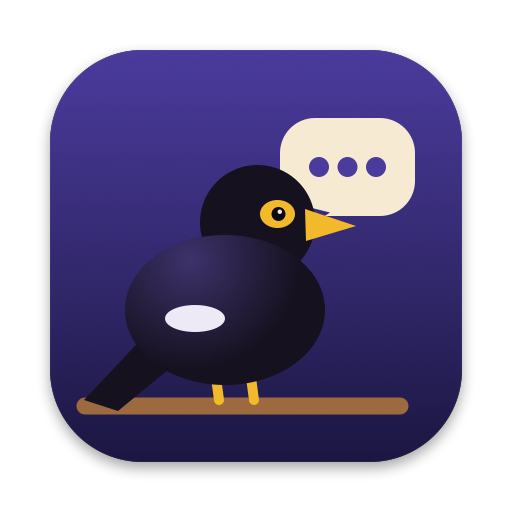
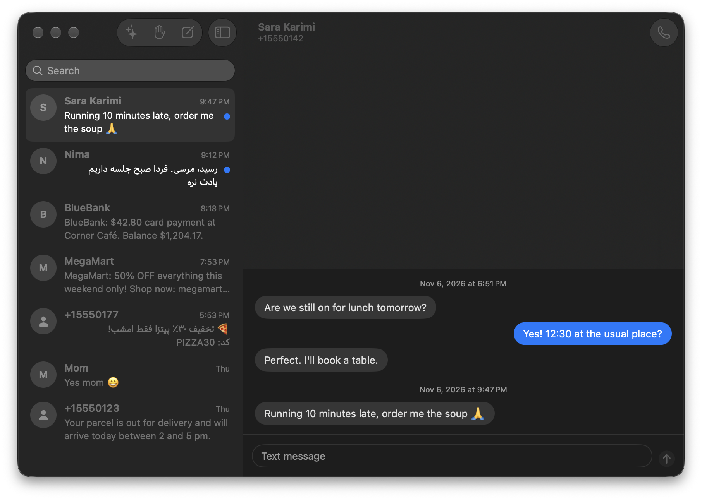
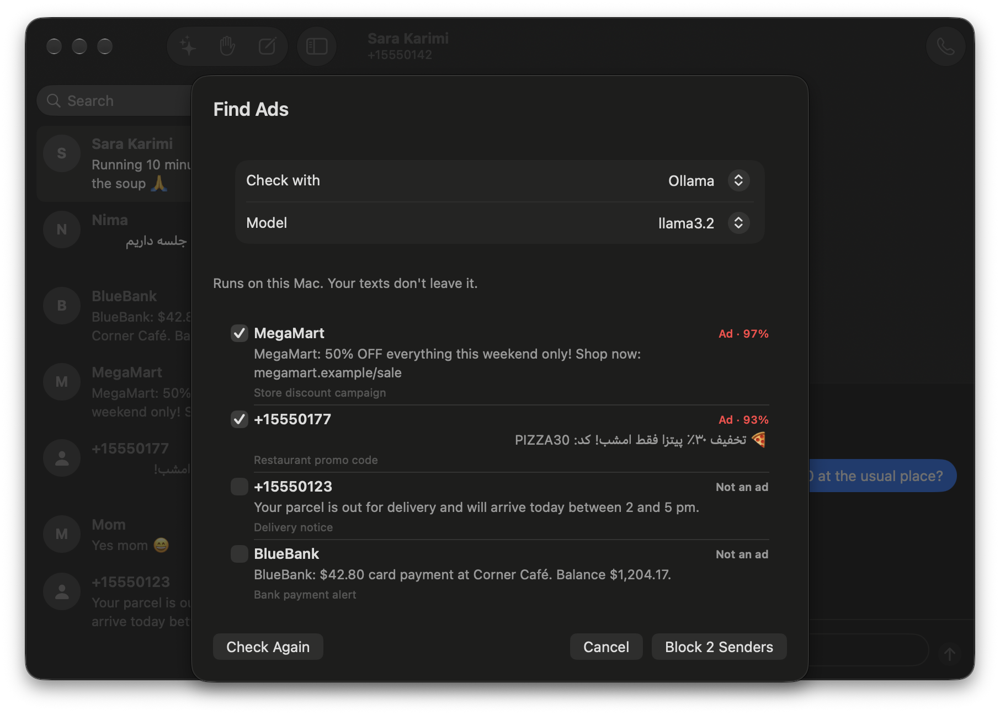
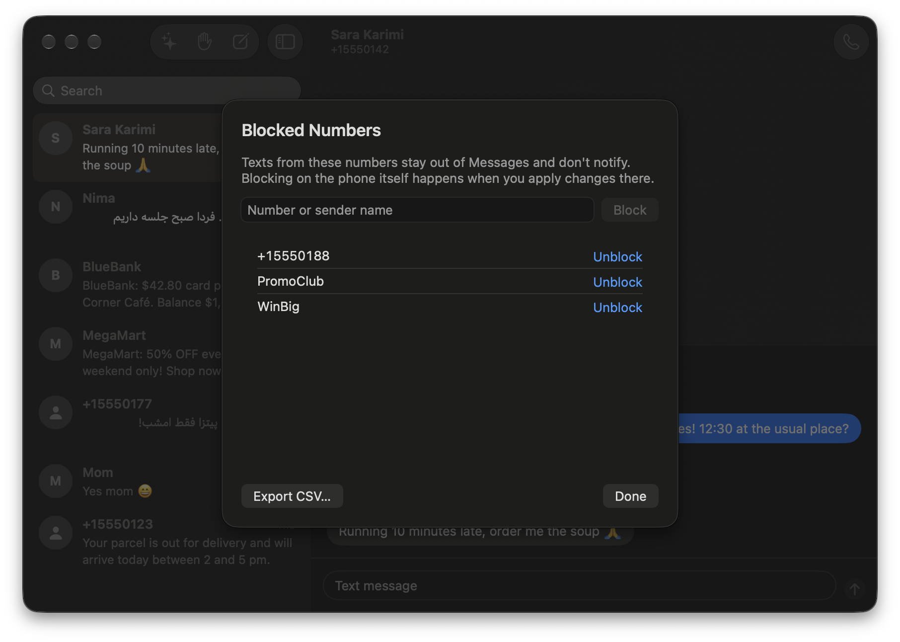
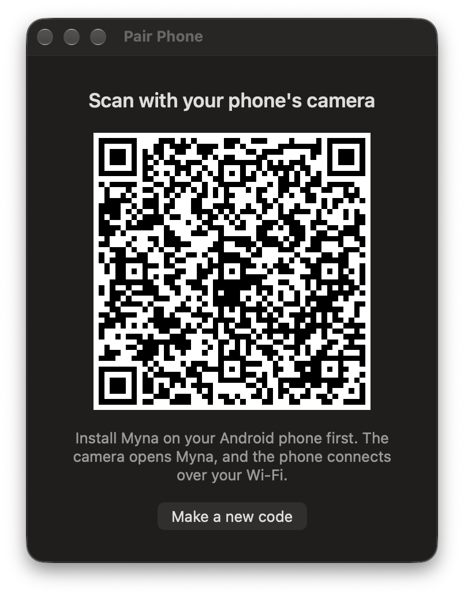
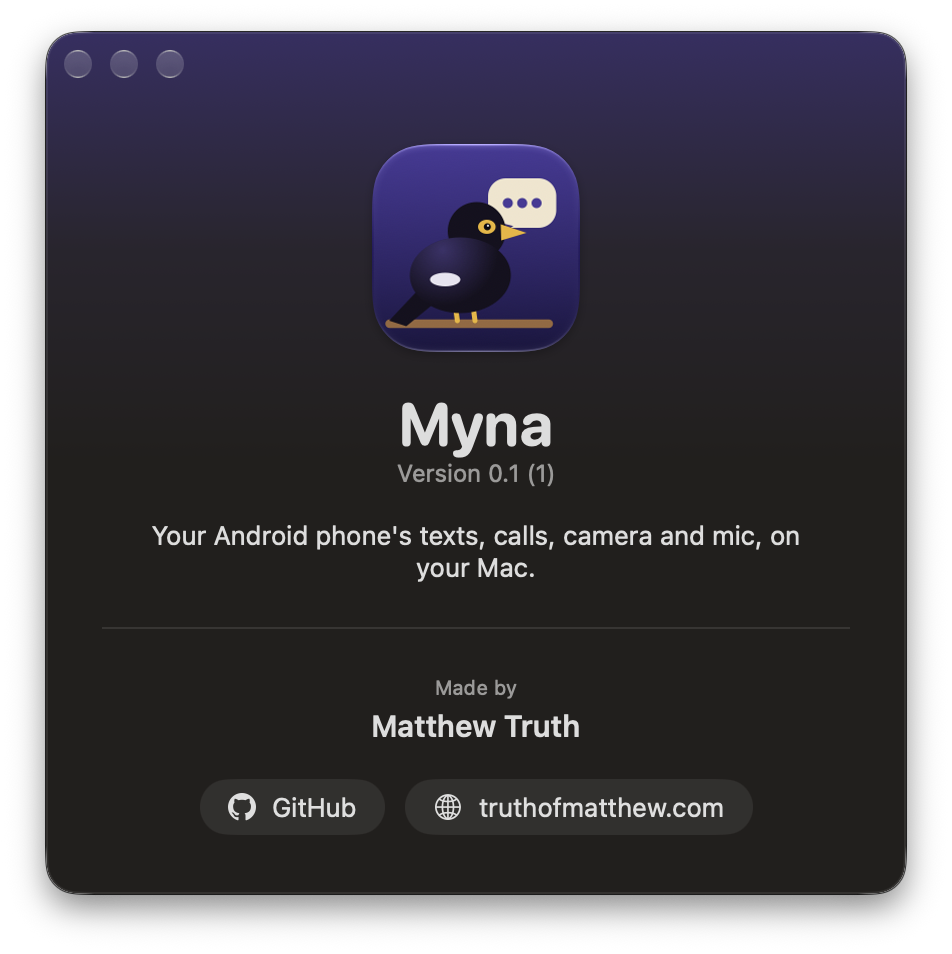

# Myna

Your Android phone's texts, calls, camera and mic, on your Mac. Read and answer texts, take and place calls, and use the phone as the webcam and mic in Google Meet, without picking the phone up.

It's a menu-bar app for the Mac and a small app for the phone, talking over your Wi-Fi (or the phone's hotspot) with an encrypted connection. No account, no server, no telemetry: nothing goes anywhere but between your two devices. It's like iPhone Mirroring's texts and calls for Android, minus the mirroring.

## What it does

- **Texts.** Your conversations in a Messages window, with contact names, search and right-to-left Persian and Arabic. Send from the Mac. New texts show a notification with **Reply**, **Mark as Read** and **Delete**.
- **Clean up in bulk.** ⌘-click, ⇧-click or ⌘A to pick conversations, then mark them read, block the senders or delete them.
- **Blocked numbers.** Block from a conversation or the Blocked Numbers list, unblock, and export the list as CSV. Blocked senders stay out of Messages and don't notify.
- **Find Ads.** Ollama or LM Studio on your Mac, or ChatGPT or Claude with your own key, sorts senders into advertising or not. You see each one with a confidence and a reason, and block the ones you pick.
- **Calls.** An incoming call shows on the Mac with **Answer** and **Decline**; hang up from the menu; call anyone from a conversation's phone button. The phone switches to its loudspeaker, so it can stay on the desk.
- **Camera and mic in Google Meet.** The Chrome (or Edge) extension adds **Myna Front Camera**, **Myna Back Camera** and **Myna Mic** to Meet's device list. The picture turns upright as you rotate the phone.

## Screenshots

| | |
| --- | --- |
|  |  |
|  |  |

The screenshots use made-up texts: run the Mac app with `-demo messages` (or `ads`, `blocked`, `about`, `pair`) to see them.

## How it works

- **Pairing.** The Mac shows a QR code; the phone's camera opens Myna with it. The code carries a random key that never leaves the two devices.
- **The connection.** The phone finds the Mac over Bonjour (or looks for it on its own hotspot), and every message is encrypted with AES-256-GCM using keys derived from the pairing key. The wire format is in [docs/PROTOCOL.md](docs/PROTOCOL.md).
- **Texts** come from the phone's SMS store; Samsung Messages (or whichever app is your SMS app) keeps writing to it as usual. Myna reads and sends; it doesn't replace your SMS app.
- **Delete, mark read and block on the phone** are things only the SMS app may do. Myna collects them into one batch; you tap a notification on the phone, Myna becomes the SMS app for a moment, applies the batch, and opens Default apps so you can hand the role back. Marking read usually skips all that: Myna presses "Mark as read" on the SMS app's own notification.
- **Calls** go through Android's call service. You talk through the phone: macOS doesn't let apps carry Bluetooth call audio, and Android doesn't let apps capture it. The details are in [docs/SPIKES.md](docs/SPIKES.md).
- **Camera and mic** are encoded on the phone (H.264 and Opus), passed through the Mac app on `127.0.0.1:8737`, and decoded in the browser by the extension, which offers them to Meet as devices. That's why it needs no virtual-camera driver and no paid Apple developer account.

## Install

You need Xcode 16 or later, [XcodeGen](https://github.com/yonaskolb/XcodeGen) (`brew install xcodegen`), Android Studio (for its JDK and SDK) and `adb`.

**Mac**

1. Clone the repo.
2. In `mac/project.yml`, set `DEVELOPMENT_TEAM` to your own Apple team ID and `PRODUCT_BUNDLE_IDENTIFIER` to your own bundle ID.
3. Run `mac/install.sh`. It builds a Release copy, puts it in `/Applications` and opens it in the menu bar. Turn on **Open at Login** in its menu if you like.

**Phone** (Android 12 or later)

1. Turn on USB debugging and plug the phone in.
2. In `android/`, run `./gradlew assembleDebug`, then `adb install app/build/outputs/apk/debug/app-debug.apk`.
3. For calls on speaker, allow Myna to manage ongoing calls once: `adb shell appops set com.truthofmatthew.myna MANAGE_ONGOING_CALLS allow`.
4. On the Mac, Myna menu › **Pair Phone…**, and scan the code with the phone's camera. Allow what Myna asks for. Texts and calls are optional; the webcam works without them.

**Chrome or Edge**

Open `chrome://extensions` (or `edge://extensions`), turn on Developer mode, choose **Load unpacked** and pick the `chrome` folder. In Meet, pick **Myna Front Camera (phone)** and **Myna Mic (phone)**.

## Known limits

- **Call audio stays on the phone.** The Mac controls calls; the phone's loudspeaker carries them. A USB Bluetooth adapter driven by BTstack could change that; see "Later" in [docs/PLAN.md](docs/PLAN.md).
- **One-time codes arrive late.** Android 17 hides texts containing one-time codes from apps like Myna for three hours.
- **No picture messages (MMS)** yet.
- **The camera is for Chrome-based browsers.** Zoom, FaceTime and Safari don't see it; a system-wide camera would need a paid Apple developer account.
- **After the phone restarts,** open Myna once; Android doesn't let camera and mic services start at boot.
- Tested on a Galaxy S24 FE with Android 17 (One UI 9) and macOS 27.

## Your data

Texts, call details, camera and mic go only between your phone and your Mac, encrypted. The Mac keeps texts in memory and the block list in its preferences; the pairing key is in the Keychain on the Mac and in Myna's private storage on the phone. The one exception is Find Ads with ChatGPT or Claude: the last few texts from senders you never replied to go to that provider, and only when you press **Check Texts**. With Ollama or LM Studio, nothing leaves your Mac.

## License

MIT. See [LICENSE](LICENSE).
