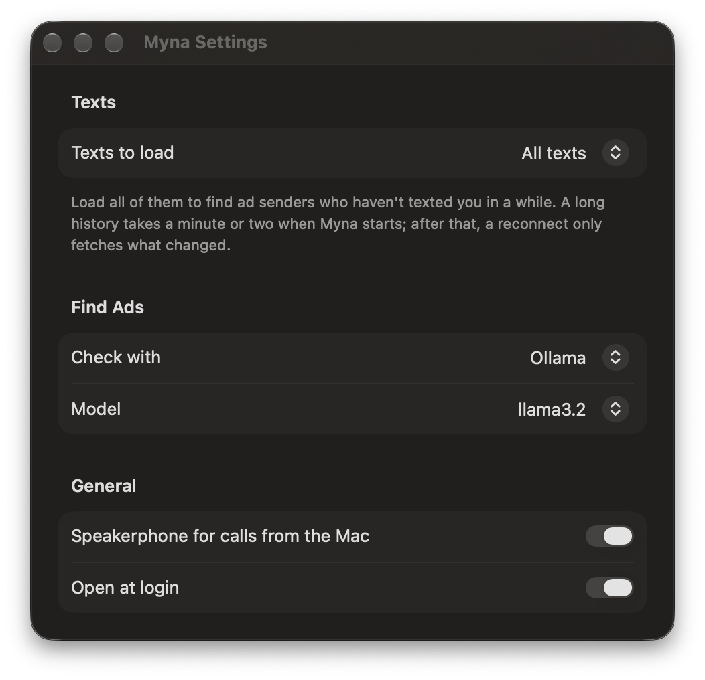
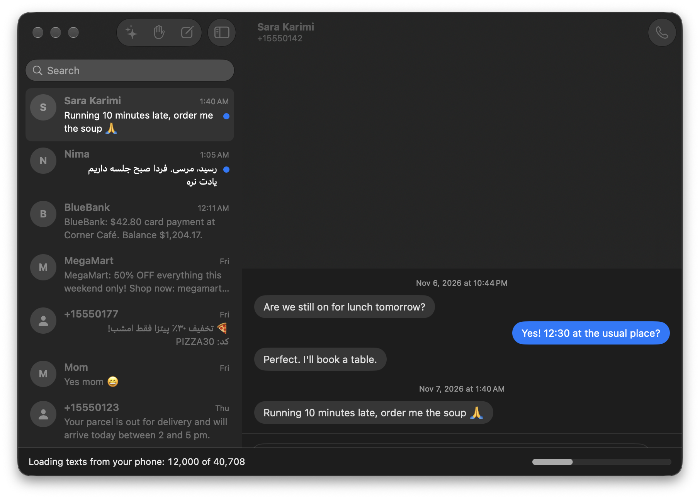

# Myna

Your Android phone's texts, calls, camera and mic, on your Mac. Read and answer texts, take and place calls, and use the phone as the webcam and mic in Google Meet, without picking the phone up.

It's a menu-bar app for the Mac and a small app for the phone, talking over your Wi-Fi (or the phone's hotspot) with an encrypted connection. No account, no server, no telemetry: nothing goes anywhere but between your two devices. It's like iPhone Mirroring's texts and calls for Android, minus the mirroring.

## What it does

- **Texts.** Your conversations in a Messages window, with contact names, search and right-to-left Persian and Arabic. Send from the Mac. New texts show a notification with **Reply**, **Mark as Read** and **Delete**.
- **Your whole history.** Myna loads every text on the phone (tested with 40,000), or only the newest 1,000, 5,000 or 20,000 if you pick that in Settings. A bar shows how far it has got. After the first load, a reconnect only fetches what changed, in a few seconds.
- **Clean up in bulk.** ⌘-click, ⇧-click or ⌘A to pick conversations, then mark them read, block the senders or delete them.
- **Blocked numbers.** Block from a conversation or the Blocked Numbers list, unblock, and export the list as CSV. Blocked senders stay out of Messages and don't notify.
- **Find Ads.** Ollama or LM Studio on your Mac, or ChatGPT or Claude with your own key, sorts the senders you've never replied to into advertising or not. You see each one with a confidence and a reason, and block the ones you pick.
- **Settings** (Myna menu › **Settings…**): how many texts to load, which AI Find Ads uses with its key and model, speakerphone for calls, and Open at Login. API keys go in the Keychain.
- **Calls.** An incoming call shows on the Mac with **Answer** and **Decline**; hang up from the menu; call anyone from a conversation's phone button. The phone switches to its loudspeaker, so it can stay on the desk.
- **Camera and mic in Google Meet.** The Chrome (or Edge) extension adds **Myna Front Camera**, **Myna Back Camera** and **Myna Mic** to Meet's device list. The picture turns upright as you rotate the phone.

## Screenshots

| | |
| --- | --- |
|  |  |
|  |  |
|  |  |

The screenshots use made-up texts: run the Mac app with `-demo messages` (or `loading`, `ads`, `blocked`, `settings`, `about`, `pair`) to see them.

## How it works

- **Pairing.** The Mac shows a QR code; the phone's camera opens Myna with it. The code carries a random key that never leaves the two devices.
- **The connection.** The phone finds the Mac over Bonjour (or looks for it on its own hotspot), and every message is encrypted with AES-256-GCM using keys derived from the pairing key. The wire format is in [docs/PROTOCOL.md](docs/PROTOCOL.md).
- **Texts** come from the phone's SMS store; Samsung Messages (or whichever app is your SMS app) keeps writing to it as usual. Myna reads and sends; it doesn't replace your SMS app.
- **Delete, mark read and block on the phone** are things only the SMS app may do. Myna collects them into one batch; you tap a notification on the phone, Myna becomes the SMS app for a moment, applies the batch, and opens Default apps so you can hand the role back. Marking read usually skips all that: Myna presses "Mark as read" on the SMS app's own notification.
- **Calls** go through Android's call service. You talk through the phone: macOS doesn't let apps carry Bluetooth call audio, and Android doesn't let apps capture it. The details are in [docs/SPIKES.md](docs/SPIKES.md).
- **Camera and mic** are encoded on the phone (H.264 and Opus), passed through the Mac app on `127.0.0.1:8737`, and decoded in the browser by the extension, which offers them to Meet as devices. That's why it needs no virtual-camera driver and no paid Apple developer account.

## Install

Download everything from [Releases](https://github.com/truthofmatthew/myna/releases/latest). Pick the guide that fits you.

### The simple way

**1. On the Mac** (macOS 14 or later)

- Download [`Myna-mac-AppleSilicon.zip`](https://github.com/truthofmatthew/myna/releases/latest/download/Myna-mac-AppleSilicon.zip) if your Mac has an M1 chip or newer, or [`Myna-mac-Intel.zip`](https://github.com/truthofmatthew/myna/releases/latest/download/Myna-mac-Intel.zip) if it's older. Not sure? Apple menu › About This Mac shows "Chip: Apple M…" or "Processor: Intel".
- Double-click the zip and drag Myna into Applications.
- Open Myna. macOS says it can't check it, because Myna isn't sold through Apple. Click **Done**, go to System Settings › Privacy & Security, scroll down and click **Open Anyway**. You only do this once.
- A small bird appears in the menu bar at the top of the screen. That's Myna.

**2. On the phone** (Android 12 or later)

- Open this page on the phone and download [`Myna-android.apk`](https://github.com/truthofmatthew/myna/releases/latest/download/Myna-android.apk).
- Open the file. Android asks whether your browser may install apps; allow it, then tap **Install**.
- Phone and Mac need to be on the same Wi-Fi, or the Mac on the phone's hotspot.
- On the Mac, click the bird › **Pair Phone…**. Point the phone's camera app at the code and tap the link it shows; Myna opens and pairs. Allow what Myna asks for. Texts and calls are optional; the camera works without them.

**3. For Google Meet** (Chrome or Edge)

- Download [`Myna-chrome-extension.zip`](https://github.com/truthofmatthew/myna/releases/latest/download/Myna-chrome-extension.zip) and double-click it.
- Type `chrome://extensions` in the address bar, turn on **Developer mode** (top right), click **Load unpacked** and pick the unzipped folder.

**Using it**

- **Texts:** click the bird › **Messages…**. Pick a conversation and type. New texts show up as Mac notifications you can reply to.
- **Calls:** an incoming call pops up on the Mac with Answer and Decline. To call someone, open their conversation and click the phone button. You talk through the phone's loudspeaker.
- **Camera in Meet:** keep Myna open on the phone. In a Meet call, open settings › Video and pick **Myna Front Camera (phone)**, and under Audio pick **Myna Mic (phone)**.
- **Ads:** in Messages, click **Find Ads**, choose an AI in Settings, then **Check Senders**. Tick the ones to block.
- After the phone restarts, open Myna on it once.

### For developers

- **Verify the downloads:** `shasum -a 256 -c SHA256SUMS.txt` against the file in the release.
- **Skip Gatekeeper's prompt:** `xattr -dr com.apple.quarantine /Applications/Myna.app`. The Mac builds are ad-hoc signed with the hardened runtime, not notarized.
- **Sideload with adb:** `adb install --user 0 Myna-android.apk`. `--user 0` keeps a second copy out of Samsung's Dual Apps and Secure Folder.
- **Calls on speaker** need one permission only `adb` can give: `adb shell appops set com.truthofmatthew.myna MANAGE_ONGOING_CALLS allow`.
- **Build it yourself:** you need Xcode 16 or later, [XcodeGen](https://github.com/yonaskolb/XcodeGen) (`brew install xcodegen`), Android Studio (for its JDK and SDK) and `adb`.
  - Mac: in `mac/project.yml`, set `DEVELOPMENT_TEAM` and `PRODUCT_BUNDLE_IDENTIFIER` to your own, then run `mac/install.sh`. It builds a Release copy, puts it in `/Applications` and opens it.
  - Phone: in `android/`, run `./gradlew assembleDebug`, then `adb install --user 0 app/build/outputs/apk/debug/app-debug.apk`. Release builds are signed only when `local.properties` has `releaseKeystoreProperties=<path to keystore.properties>`. A self-built copy and the downloaded APK use different keys, so uninstall one before installing the other.
  - Extension: load the `chrome` folder unpacked.
- **How the pieces talk:** the phone and Mac find each other over Bonjour (`_myna._tcp`) and talk over one TCP connection of length-prefixed frames, encrypted with AES-256-GCM. The keys come from the pairing key in the QR code, via HKDF. The extension reads camera and mic from the Mac app on `127.0.0.1:8737`. Messages are in [docs/PROTOCOL.md](docs/PROTOCOL.md).

## Known limits

- **Call audio stays on the phone.** The Mac controls calls; the phone's loudspeaker carries them. A USB Bluetooth adapter driven by BTstack could change that; see "Later" in [docs/PLAN.md](docs/PLAN.md).
- **One-time codes arrive late.** Android 17 hides texts containing one-time codes from apps like Myna for three hours.
- **No picture messages (MMS)** yet.
- **The camera is for Chrome-based browsers.** Zoom, FaceTime and Safari don't see it; a system-wide camera would need a paid Apple developer account.
- **After the phone restarts,** open Myna once; Android doesn't let camera and mic services start at boot.
- **The menu bar icon can be hidden** when the menu bar is full (behind the notch). Open Myna from Spotlight or Finder and its Messages window comes up.
- Tested on a Galaxy S24 FE with Android 17 (One UI 9) and macOS 27.

## Your data

Texts, call details, camera and mic go only between your phone and your Mac, encrypted. The Mac keeps texts in memory and the block list in its preferences; the pairing key is in the Keychain on the Mac and in Myna's private storage on the phone. The one exception is Find Ads with ChatGPT or Claude: the last three texts from each sender you never replied to go to that provider, and only when you press **Check Senders**. With Ollama or LM Studio, nothing leaves your Mac.

## License

MIT. See [LICENSE](LICENSE).
